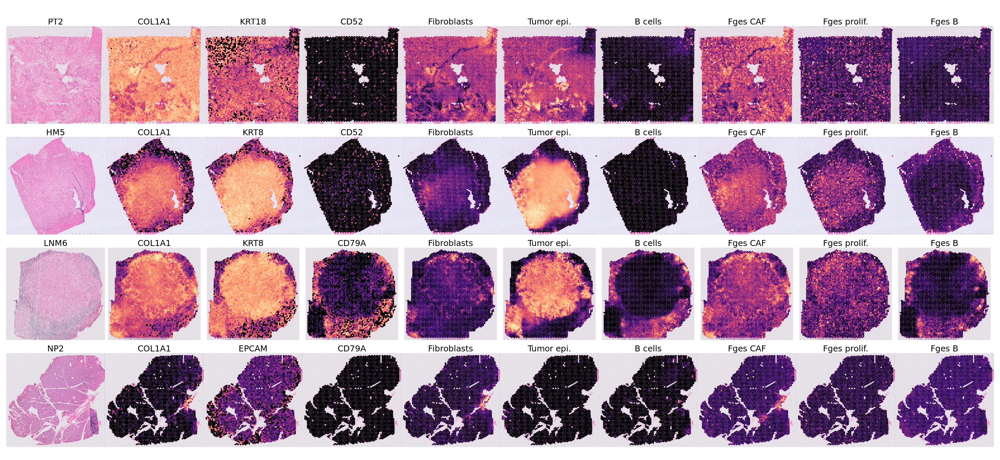
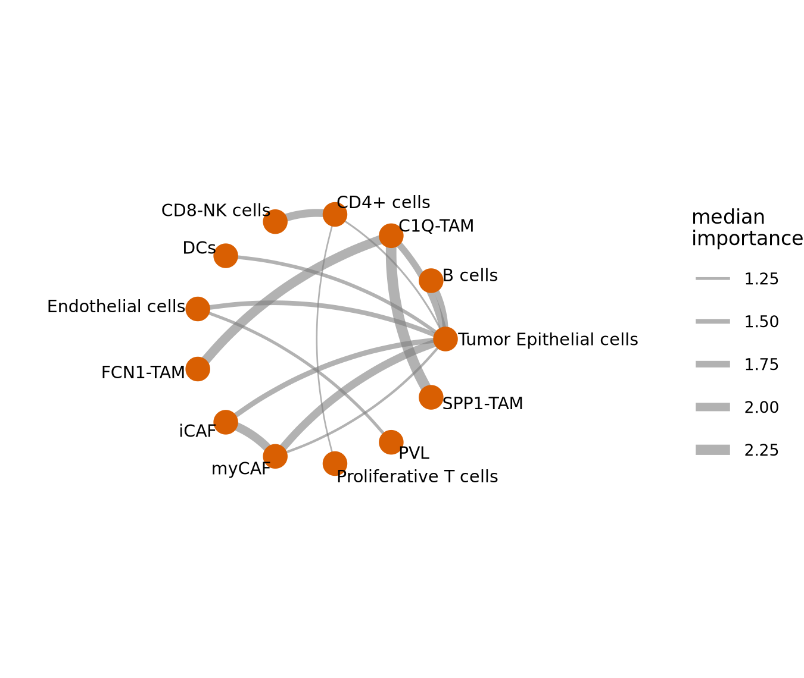
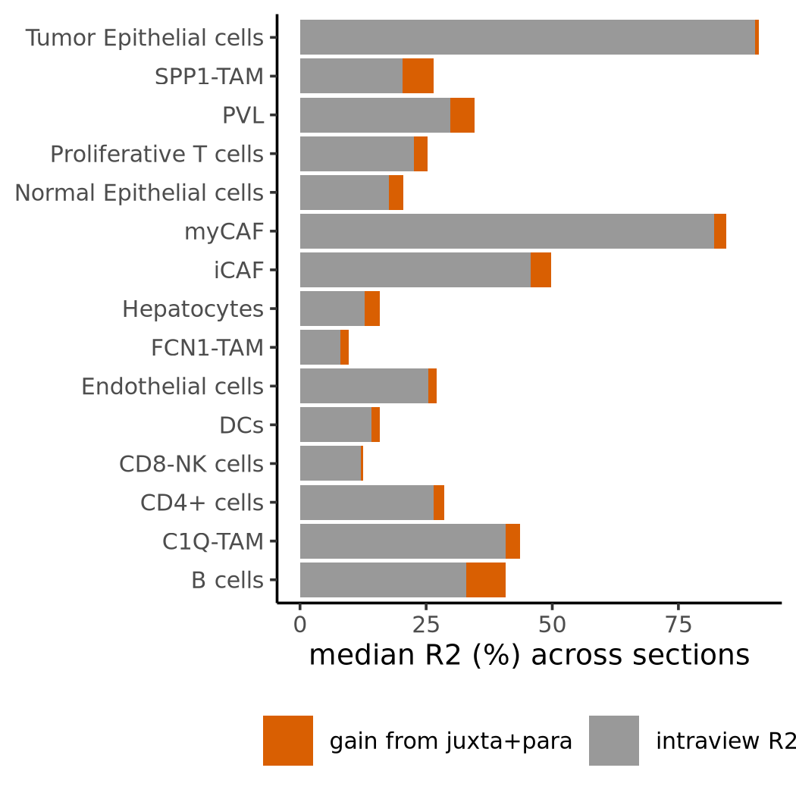

# Spatial transcriptomics of primary and metastatic pancreatic cancer

A reanalysis of the Visium v1 FFPE dataset of [Khaliq et al., *Nat Genet* 2024](https://pubmed.ncbi.nlm.nih.gov/39294496/) (GEO GSE272362): 29 sections from primary PDAC, liver and lymph-node metastases and adjacent normal pancreas. It was done as a course assignment on spatial transcriptomics analysis and covers spot-level QC, cell-type deconvolution with RCTD and spatial cell-type interaction analysis with MISTy.

The full write-up is in [`report/report.md`](report/report.md) ([PDF](report/report.pdf)).

## Main results

- The count matrices provided for the course are already filtered by the authors (spot numbers equal the post-QC numbers in Supplementary Table 2). The FFPE probe panel has no mitochondrial or ribosomal genes, so the usual scRNA-seq filters on these fractions have no effect.
- Spots removed by the authors are mostly scattered edge spots, except in three liver metastases where whole regions of adjacent normal liver parenchyma were removed.
- RCTD (full mode, 15 cell states from the authors' scRNA-seq atlas) recovers the expected composition: primary tumours are dominated by tumour cells and myCAFs (mean myCAF proportion 0.39 against 0.11 in liver metastases). Hepatocytes appear only in liver metastases.
- MISTy (intra-, juxta- and paraview) reproduces most interactions of Fig. 2a of the paper: tumour–myCAF, myCAF–iCAF, PVL–endothelial, CD4–CD8/NK and the co-localisation of SPP1, C1Q and FCN1 TAMs. In all five primary tumours with enough CAF-rich spots, iCAFs lie further from the tumour than myCAFs.

<p align="center"></p>
<p align="center"> </p>

## Repository layout

```
R/01_qc.R            load h5ad + spatial files, QC flags, scRNA-style preprocessing
R/02_rctd.R          RCTD deconvolution, one section per call
R/03_misty.R         MISTy on RCTD proportions, median importances across sections
R/04_figures.R       all figures and summary tables
slurm/               Slurm templates for the RCTD array and MISTy
tools/               conversion of the paper's supplementary Excel tables to CSV
data/                input layout and data sources (raw data not tracked)
results/tables/      summary tables, including per-spot RCTD weights (rctd_weights.csv.gz)
figures/             figures used in the report
report/              report (Markdown and PDF)
```

## Reproducing

```bash
conda env create -f environment.yml
conda activate pdac-visium-spatial
# place the data as described in data/README.md, then from the repository root:
Rscript R/01_qc.R
sbatch slurm/rctd_array.sbatch            # or: Rscript R/02_rctd.R <section>
sbatch slurm/misty.sbatch                 # or: Rscript R/03_misty.R
Rscript R/04_figures.R
pandoc report/report.md -s --css report/style.css --resource-path=report -o report/report.html && weasyprint report/report.html report/report.pdf
```

RCTD takes 25 to 40 min and about 25 GB of memory per section with 16 cores; MISTy takes about 5 min for all sections.

The code was written with the help of Claude (Anthropic).
