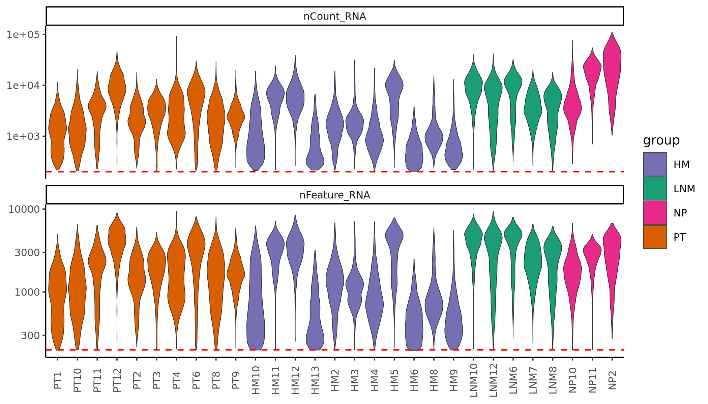
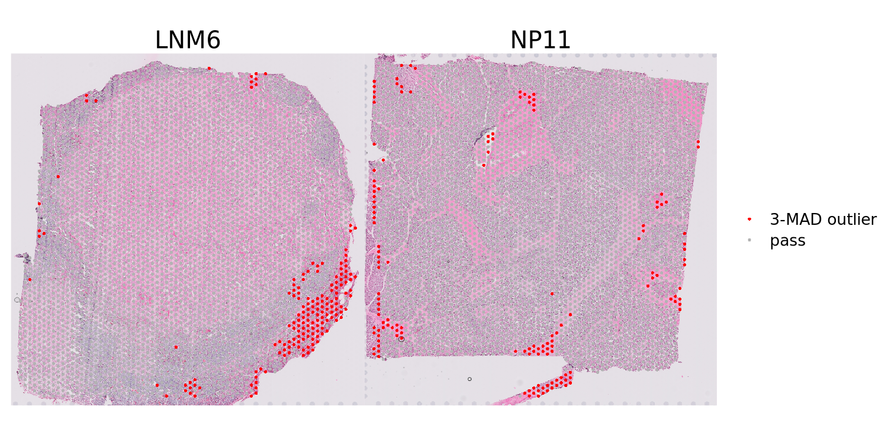
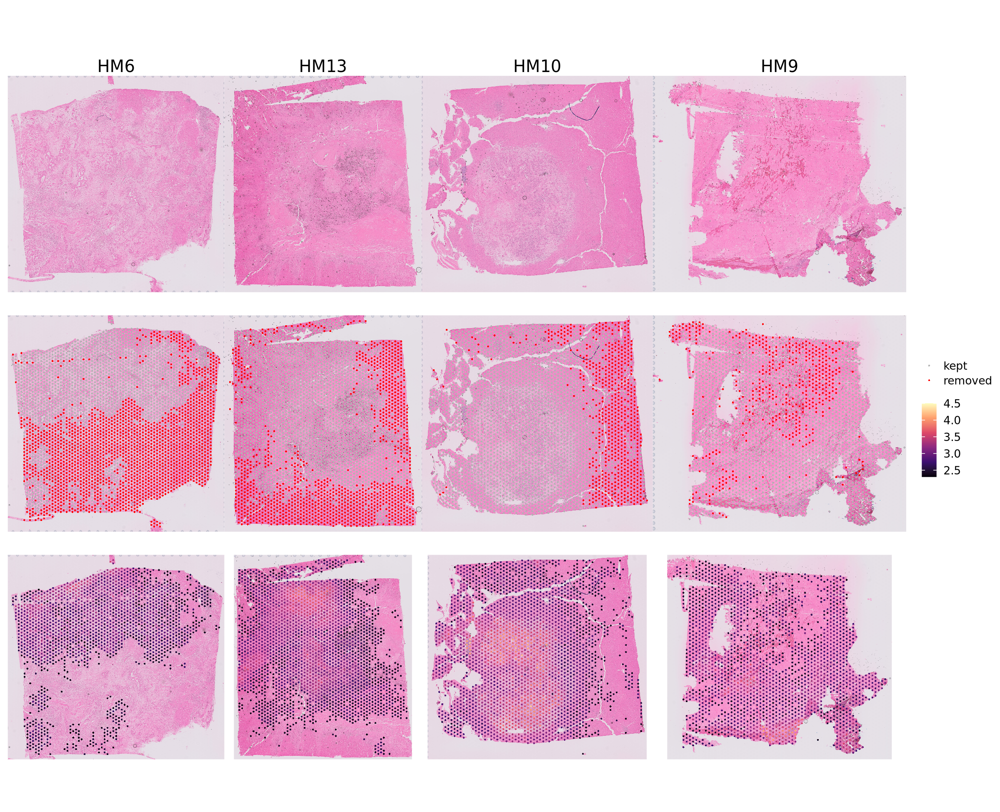
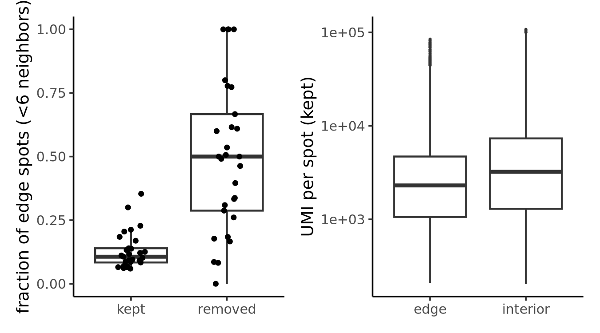
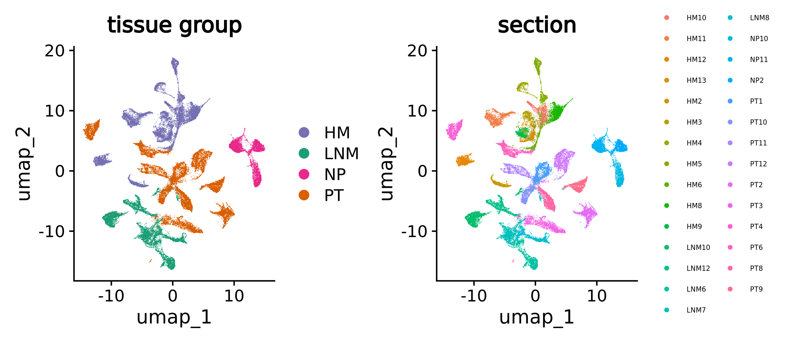
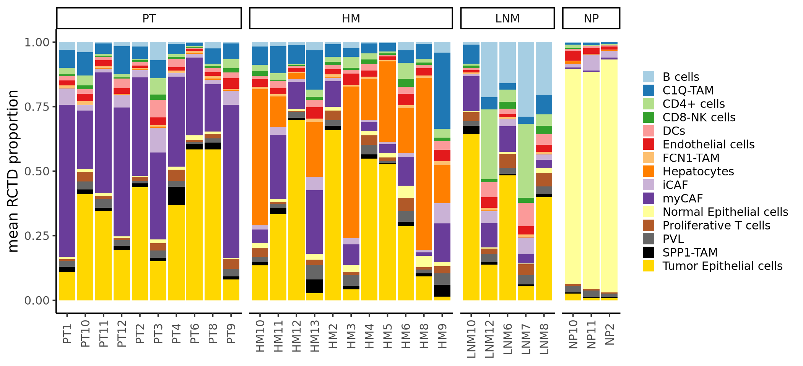
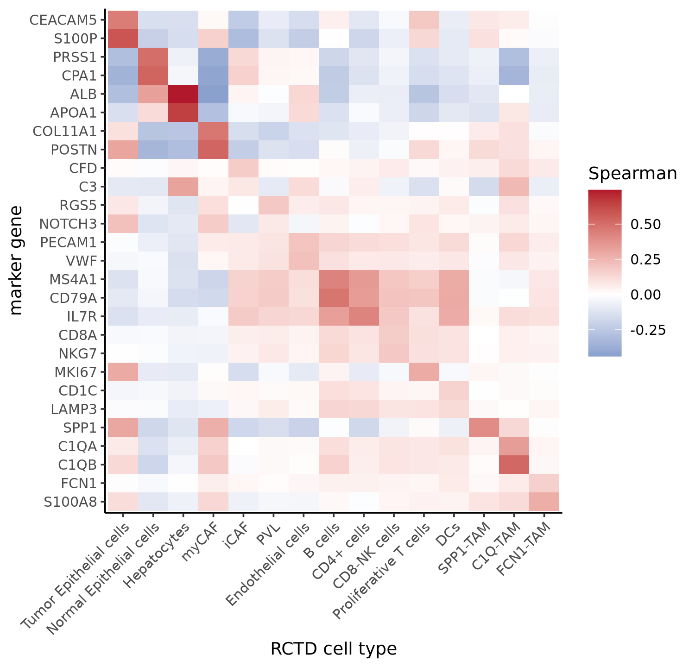
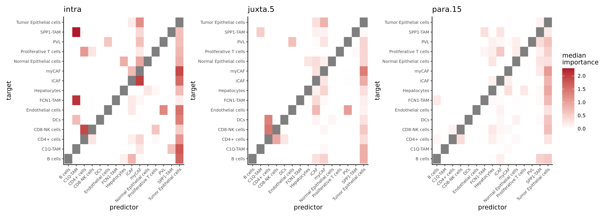
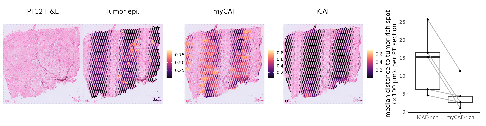

This report reanalyses the Visium v1 FFPE data of Khaliq et al. (*Nat Genet* 2024; GEO GSE272362) following the course assignment. Of the 30 sections provided, HM3335 (IU_PDA_HM2_2) was excluded because its count matrix is identical, value for value, to that of HM3336 (IU_PDA_HM2), while its own tissue-position file contains only 963 in-tissue spots against 2,478 spots in the matrix. The remaining 29 sections comprise 10 primary tumours (PT), 11 liver metastases (HM), 5 lymph-node metastases (LNM) and 3 adjacent normal pancreas samples (NP), 90,537 spots in total. All analyses were done in R. Code was written with the help of Claude, an AI coding assistant, and checked and run by the author.

# 0. Environment

The analysis environment was built with conda (micromamba) from conda-forge and bioconda: R 4.3.3, Seurat 5.3.0, spacexr 2.2.1 (RCTD), mistyR 1.10.0, plus hdf5r for reading the h5ad files directly. The package list is in `environment.yml`. RCTD was run as a Slurm array with one section per task (16 cores, 25 to 40 min and about 25 GB of memory per section); the other steps run on a single node.

# 1. Preprocessing and quality control

## 1a. Is a single-cell QC protocol appropriate?

The preprocessing in the paper (Extended Data Fig. 1a) starts from Space Ranger 2.0.0 output, corrects spot swapping with SpotClean, removes spots with fewer than 200 detected genes and UMIs, and uses Seurat's `PercentageFeatureSet()` to deal with mitochondrial, ribosomal, haemoglobin, heat-shock and dissociation genes. Of 39 samples, 30 passed QC; both adjacent normal liver samples failed. The count matrices provided for the assignment are already the post-QC matrices: for every section the number of spots equals *Number_of_spots_PostQC* in Supplementary Table 2 (for example HM10, 2,978 spots before and 2,348 after QC, 2,348 in the h5ad). GEO hosts only images and positions, so the counts of removed spots are not available.

Applying a scRNA-seq protocol unchanged is not appropriate, for several reasons. The unit of QC is a 55 µm spot containing roughly 1 to 10 cells, often of different types, so the notion of a doublet does not apply; mixtures are expected and are handled later by deconvolution. The mitochondrial fraction, the main indicator of damaged cells in scRNA-seq, cannot be computed here: the FFPE probe panel contains no MT- genes and no RPS/RPL genes (0 of each among 17,893 features), so filters on these fractions do nothing. The tissue is not dissociated, so heat-shock and dissociation genes reflect tissue state rather than handling stress. A low UMI count in a spot can mean a technical problem, but it can equally come from tissue that is poor in cells (fibrous stroma, fat, necrosis) or from a region with generally degraded RNA. Finally, Visium adds information that scRNA-seq lacks: spot position. Spots on tissue edges, folds and tears are more exposed to diffusion and incomplete capture, and QC metrics should be inspected on the H&E image rather than only as distributions.

## 1b. Intermediate steps used to define QC criteria

Sequencing depth differs widely between sections (Fig. 1a): the median UMI per spot ranges from 492 (HM6) to 19,995 (NP2). HM6, HM13, HM9, HM10 and HM4 have medians below 1,000. Only 15 of the 90,537 retained spots fall below 200 genes or UMIs, which confirms that the paper's threshold had already been applied.

A single global threshold therefore behaves very differently across sections. It removes a large share of spots in shallow sections and almost nothing in deep ones. I used two criteria together, both recorded as flags rather than applied as deletions. The first is the paper's criterion (fewer than 200 genes or UMIs). The second is section-specific: a spot is flagged when its log10 UMI lies more than three median absolute deviations below the median of its own section. The second rule flags 865 spots (1.0%), concentrated in a few deep sections. In NP11, for instance, it corresponds to a threshold of 3,240 UMIs. Flagged spots lie on the tissue edge three times as often as unflagged spots (35% against 12%).

{width=70%}

On the H&E images (Fig. 1b), the flagged spots in NP11 lie partly along the section border and partly in the pale fibrous septa between pancreatic lobules. In LNM6 they form a patch of fibrous tissue at the lower right. Part of the low-UMI signal therefore reflects cell-poor stroma rather than poor capture. Removing these spots would remove real tissue compartments, so they were kept and all 90,537 spots were used downstream.

## 1c. Do the filtered spots correspond to low-quality spots?

Because the removed spots are missing from the matrices, I reconstructed them as spots marked `in_tissue = 1` in the position files but absent from the h5ad. The authors removed 5,520 such spots (5.7%), very unevenly: 53% of HM6, 35% of HM13, 21% of HM10 and 19% of HM9, but less than 3% in most other sections.

{width=55%}

Two kinds of removal can be distinguished. In most sections only scattered spots were removed, and they sit on the tissue edge. Per section, the median fraction of edge spots is about 0.5 among removed spots and 0.1 among kept spots (Fig. 1d, left), and retained edge spots also have fewer UMIs than interior spots (Fig. 1d, right). These removals fit the usual picture of low-quality spots caused by incomplete capture at the border and by tears.

In HM6, HM13 and HM10, by contrast, the removed spots form large contiguous areas (Fig. 1c). On the H&E these are homogeneous, pale regions of adjacent liver parenchyma (the right side of HM10, the lower part of HM13 and the lower half of HM6), not folds or empty areas. The spots that were kept in these sections also have low UMI counts. Together with the failure of both normal liver samples, this suggests that normal liver gives generally weak signal with this FFPE probe assay.

So the filtered spots are low-quality by the count criterion, but the filtering is not random. It falls mostly on normal liver parenchyma, which leaves adjacent liver under-represented in the liver-metastasis sections. This affects later estimates of hepatocyte content and of the tumour–liver interface.

## Standard dimensionality reduction

For comparison, the retained spots were processed as single cells would be: log-normalisation, 2,000 variable genes, 30 principal components, UMAP and Louvain clustering (resolution 0.3, 27 clusters).

{width=80%}

The spots group almost entirely by section (Fig. 1e), and sections of the same tissue type form separate islands. This reflects patient and section effects, and also the mixed nature of spots: a cluster here stands for a characteristic mixture within one section, not for a cell type. For this reason spots were annotated by deconvolution rather than by clustering, as in the paper.

# 2. Cell-type annotation by deconvolution

## 2a. RCTD with the authors' scRNA-seq reference

The reference is the authors' integrated scRNA-seq atlas (`scRNA-seq_Data_post_qc.rds`, Zenodo; 112,165 cells from the Peng, Raghavan and MacParland datasets). The 15 cell states of the paper are stored in the column `celltype_new1`, which matches Celltype_Tier2 of Supplementary Data 4. RCTD was run in full mode, as in the paper, separately for each section (`UMI_min = 20`), and the weights of each spot were normalised to proportions. The reference and the probe panel share 16,573 genes.

| Cell type | PT | HM | LNM | NP |
|---|---|---|---|---|
| Tumour epithelial | 0.32 | 0.32 | 0.37 | 0.01 |
| myCAF | 0.39 | 0.11 | 0.08 | 0.01 |
| iCAF | 0.04 | 0.02 | 0.03 | 0.04 |
| Hepatocytes | 0.00 | 0.27 | 0.00 | 0.00 |
| Normal epithelial | 0.01 | 0.02 | 0.01 | 0.86 |
| CD4+ cells | 0.02 | 0.02 | 0.12 | 0.01 |
| C1Q-TAM | 0.06 | 0.09 | 0.05 | 0.01 |

The composition agrees with the paper. Primary tumours are dominated by tumour epithelial cells and myCAFs, consistent with the dense desmoplastic stroma of PDAC. Hepatocytes appear only in liver metastases, normal pancreas consists mostly of normal epithelium, and lymph-node metastases carry the largest share of CD4+ T cells, B cells and dendritic cells. The myCAF fraction drops from 0.39 in primary tumours to 0.11 in liver metastases, in line with the paper's conclusion that primary tumours are fibrotic while metastases are dominated by proliferating tumour cells.

## 2b. Visualisation of deconvolution results, markers and gene sets

{width=55%}

As a check on the deconvolution, Figure 2b correlates canonical markers with the estimated proportions. Each well-represented cell type is matched by its own markers: CEACAM5 and S100P with tumour epithelium, PRSS1 and CPA1 with normal epithelium, ALB and APOA1 with hepatocytes, COL11A1 and POSTN with myCAF, MS4A1 and CD79A with B cells, IL7R with CD4+ cells, SPP1 with SPP1-TAM, C1QA and C1QB with C1Q-TAM, and FCN1 and S100A8 with FCN1-TAM. Correlations are weak for iCAF (CFD), PVL (RGS5, NOTCH3), CD8-NK cells and dendritic cells. These types make up a small share of each spot and their markers are sparsely detected in the probe data, so their estimates are the least reliable.

Figure 2c follows Fig. 1c–e of the paper, with the same sections and genes (COL1A1/KRT18/CD52 for PT2, COL1A1/KRT8/CD52 for HM5, COL1A1/KRT8/CD79A for LNM6 and COL1A1/EPCAM/CD79A for NP2). The gene sets are the functional gene expression signatures (Fges) of Bagaev et al. (*Cancer Cell* 2021), scored with `AddModuleScore`. In PT2, COL1A1, the CAF score and the fibroblast fraction cover nearly the whole section, with tumour cells scattered in nests and very few B cells. In HM5 the tumour occupies the centre of the section and is surrounded by liver; KRT8, the tumour fraction and the proliferation score are high in the centre, and COL1A1 and the CAF score are also highest within the tumour, particularly along its left border, and low in the surrounding liver. In LNM6 a central tumour is surrounded by a rim of B cells, seen consistently in CD79A, the RCTD B-cell fraction and the B-cell score. In NP2 tumour, CAF and B-cell signals are all low, apart from a small stromal area on the right. These patterns reproduce Fig. 1c–e of the paper.

# 3. Cell-type interaction analysis

## 3a. MISTy and the interactions of Fig. 2a

I used MISTy, as in the paper, with the 15 RCTD proportions of each spot as features. Each section was modelled with three views: the intraview (the spot itself), a juxtaview summing neighbours within 5 spots (`neighbor.thr = 5`) and a paraview with distance weighting over 15 spots (`l = 15`). Coordinates were derived from the array row and column, in units of the 100 µm spot spacing. After fitting all 29 sections, the standardised importance of each predictor–target pair in each view was summarised by its median across sections, which corresponds to the "median standardized importance" of the paper.

<figure> <figcaption>Figure 3a (left). Variance explained for each target: intraview R² (grey) and the gain from adding the juxta- and paraviews (orange), medians across sections (compare Extended Data Fig. 2a). Figure 3c (right). Intraview interaction network, edges with median importance above 1 (compare Fig. 2a).</figcaption></figure>

The intraview explains most of the variance: the median R² is 28.7% with the intraview alone and 33.7% with all three views, a median gain of 2.6 percentage points. This agrees with the paper, where the intraview was the most predictive. The neighbourhood views help most for B cells, SPP1-TAM and PVL; the paper names PVL, B cells and C1Q-TAM, so two of the three agree.

| Predictor → target | Median importance | In paper Fig. 2a |
|---|---|---|
| C1Q-TAM → SPP1-TAM | 2.29 | yes |
| C1Q-TAM → FCN1-TAM | 2.12 | yes |
| myCAF → iCAF | 2.02 | yes |
| CD4+ → CD8-NK | 1.93 | yes |
| Tumour epithelial → myCAF | 1.92 | yes (strongest in ED Fig. 2b) |
| Tumour epithelial → C1Q-TAM | 1.76 | yes |
| Tumour epithelial → B cells | 1.63 | yes |
| Tumour epithelial → DCs | 1.36 | yes |
| PVL → endothelial | 1.28 | yes |
| CD4+ → proliferative T | 1.09 | yes |
| Hepatocytes → normal epithelial | 0.87 | yes (below the cut-off of 1 here) |

Nearly all edges of Fig. 2a are recovered, including the co-localisation of the three TAM subsets and the predominance of homotypic links among immune cells. Two differences stand out. Tumour epithelium has more outgoing edges in this analysis (also to iCAF and endothelial cells), and the link between normal epithelium and hepatocytes is weaker. A likely reason for the second difference is that the link depends on the few sections containing liver parenchyma: one of them (HM2_2) is missing here, and much of the parenchyma in other sections was removed by QC (Section 1c). In the juxta- and paraviews the leading pairs are again tumour → myCAF, CD4+ → CD8-NK and PVL → endothelial, so these relationships hold over larger distances as well.

## 3b. Agreement with histology

The paper reports that myCAFs are juxtaposed to tumour cells while iCAFs lie further away. To test this, I defined tumour-rich spots (tumour epithelial proportion above 0.5) and myCAF- and iCAF-rich spots (proportion above 0.3), and measured the distance from each CAF-rich spot to the nearest tumour-rich spot. In each of the five primary tumours with at least 20 spots of both CAF types, iCAF-rich spots were further from the tumour than myCAF-rich spots: median distances of 4.6 to 25.7 against 1.0 to 11.4 spot spacings. In PT2 the medians were 15.3 against 1.0, that is about 1.5 mm against 0.1 mm. In PT12 (Fig. 3d), myCAF proportions are high across most of the section between the tumour-rich patches, while the iCAF signal is weak and confined to the lower left of the section. The tumour → myCAF importance is highest in primary tumours (3.23, against 1.32 in liver metastases).

The other interactions are also plausible histologically, but I did not verify them region by region. PVL and endothelial cells are expected together in vessels, where pericytes and smooth muscle cells surround the endothelium, and the PVL → endothelial pair remains among the strongest in the juxtaview. The three TAM subsets co-localise with each other and with tumour cells. The paper places such mixtures of macrophages, T cells and tumour cells at the invasive border between tumour and adjacent tissue (ecotype CC7, confirmed by CD68 and CD163 staining); I did not repeat the ecotype clustering. Among lymphocytes, the CD4+ → CD8-NK importance is highest in liver metastases (2.30) and normal pancreas (2.06), but only 0.42 in lymph-node metastases. In lymph nodes T cells are abundant and spread throughout the tissue (CD4+ mean proportion 0.12), so one type does not predict the location of another. In liver and pancreas T cells gather in a few infiltrates, where they occur together. In LNM6 the B-cell rim around the tumour (Fig. 2c) corresponds to the remaining lymph-node tissue.

# 4. Limitations

The data had already been filtered by the authors, so the effect of different QC thresholds could only be assessed through spot positions and the counts of the retained spots. The excluded section HM2_2 and the removal of normal liver parenchyma both weaken liver-related signals. RCTD estimates are uncertain for rare cell types (iCAF, PVL, dendritic and CD8-NK cells), and MISTy edges involving them should be read with caution. MISTy importance measures statistical predictability of one cell type's abundance from another's, not a direct ligand–receptor interaction; the paper likewise treats these as candidate interactions and validates some by immunohistochemistry. Package versions differ from the paper (Seurat 5.3 and mistyR 1.10 here, Seurat 4.3 and mistyR 1.9.1 in the paper), so individual values differ, but the main conclusions are the same.

# References

Khaliq AM et al. Spatial transcriptomic analysis of primary and metastatic pancreatic cancers highlights tumor microenvironmental heterogeneity. *Nat Genet* 56, 2455–2465 (2024).

Cable DM et al. Robust decomposition of cell type mixtures in spatial transcriptomics. *Nat Biotechnol* 40, 517–526 (2022).

Tanevski J et al. Explainable multiview framework for dissecting spatial relationships from highly multiplexed data. *Genome Biol* 23, 97 (2022).

Bagaev A et al. Conserved pan-cancer microenvironment subtypes predict response to immunotherapy. *Cancer Cell* 39, 845–865 (2021).
